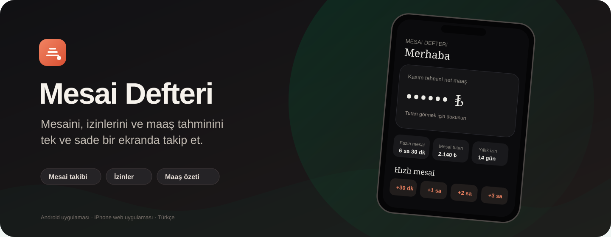
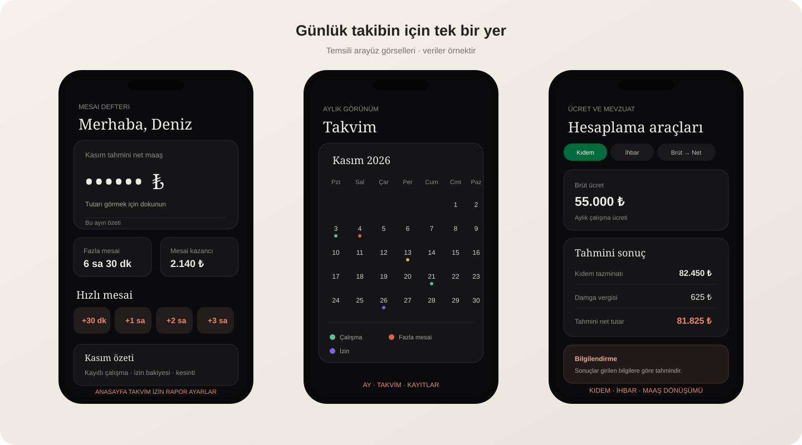

<div align="center">



<h1>Mesai Defteri</h1>

<p><strong>Çalışma günlerini, fazla mesaini, izinlerini ve maaş tahminini tek yerde takip et.</strong></p>

<p>
  <a href="https://mesai-defteri-ios-test.pages.dev/">iPhone’da web uygulamasını aç</a>
  ·
  <a href="releases/MesaiDefteri-Android-debug.apk">Android deneme APK’sını indir</a>
</p>

</div>

Mesai Defteri; çalışma düzenini ve ücret bilgilerini kaydederek mesai, izin ve dönem özetlerini görmeyi kolaylaştıran Türkçe bir mobil uygulamadır. Android’de kurulabilir uygulama, iPhone’da ise şu an Safari’den ana ekrana eklenebilen web uygulaması olarak kullanılabilir.

> Görsellerdeki rakamlar ve kayıtlar örnektir; uygulamadan alınmış kişisel veri içermez.

## Uygulama ekranları



## Neler yapabilirsin?

- **Mesai ve çalışma kaydı:** Günlük çalışma süresini ve fazla mesaiyi kaydet; ana ekrandaki hızlı düğmelerle bugüne 30 dakika, 1, 2 veya 3 saat ekle.
- **Maaş görünümü:** Aylık veya saatlik ücretini; net ya da brüt olarak tanımla. Tahmini net maaş ve mesai kazancı özetlerini takip et. Ana ekrandaki maaş tutarı gizli başlar; görmek için dokun.
- **İzin takibi:** Yıllık, ücretsiz, saatlik, raporlu ve diğer izin türlerini kaydet; izin bakiyesini ve çalışma günlerine etkisini gör.
- **Takvim ve vardiya:** Günleri takvimde incele, çalışma düzenini ve vardiyaları tanımla.
- **Raporlar:** Aylık ve yıllık çalışma, izin, kesinti ve kazanç özetlerine bak.
- **Hesaplama araçları:** Brüt/net maaş dönüşümü, kıdem ve ihbar tazminatı, işsizlik ödeneği ve kısa çalışma ödeneği için tahmin al.
- **Hatırlatıcılar:** Android uygulamasında yerel bildirimleri ayarla ve bildirim iznini yönet.
- **Yedekleme:** Verilerini JSON dosyası olarak dışa aktar ve daha sonra geri yükle.
- **Görünüm:** Açık, koyu veya sistem temasını ve vurgu rengini seç.

## İndirme ve kullanım

| Platform | Kullanım | Durum |
| --- | --- | --- |
| Android | [Deneme APK’sını indir](releases/MesaiDefteri-Android-debug.apk), telefonda aç ve kurulumu tamamla. Android, ilk kurulumda bu kaynağa ait uygulama yükleme izni isteyebilir. | Debug imzalı test sürümü |
| iPhone | [Safari’de aç](https://mesai-defteri-ios-test.pages.dev/), **Paylaş → Ana Ekrana Ekle** adımlarını izle. | Geçici web uygulaması (PWA) |
| iOS yerel uygulaması | Bu depoda Xcode projesi bulunur; cihaza IPA yüklemek için Mac, Xcode ve Apple imzalama gerekir. | IPA henüz üretilmedi |

Android APK, telefona doğrudan kurulabilen deneme paketidir; Google Play sürümü değildir. Mevcut APK debug anahtarıyla imzalanmıştır. Uygulamayı farklı bir imza anahtarıyla yeniden paketlemek, mevcut kurulumun üzerine güncellemeyi engelleyebilir. Kalıcı dağıtım öncesinde aynı anahtarı güvenli biçimde saklayarak release imzalı sürüm oluşturulmalıdır.

## Veriler ve bildirimler

Uygulama profil, maaş, mesai, izin ve ayar verilerini cihazın yerel depolamasında tutar. Hesap açma veya cihazlar arası eşitleme özelliği yoktur. Tarayıcı verilerini temizlemek uygulama kayıtlarını silebilir; bu nedenle **Ayarlar → Yedek** bölümünden düzenli yedek almak iyi olur.

Android sürümü, işletim sisteminin yerel bildirimlerini kullanır. iPhone’daki web sürümünde uygulama içi hatırlatmalar uygulama çalışırken kontrol edilir; uygulama kapalıyken her gün çalışacağı garanti edilmez. Yerel iOS uygulaması için Xcode projesi gerekir.

## Hesaplama notu

Ücret ve mevzuat araçları girilen bilgilere ve uygulamadaki düzenlenebilir varsayılanlara dayalı tahmin verir. Bordro, iş hukuku veya mali müşavirlik danışmanlığı yerine geçmez. Vergi dilimleri, istisnalar ve yasal tutarlar değişebileceğinden sonuçları resmî kaynaklardan ve uzmanlardan kontrol et.

## Teknik yapı

- React ve TypeScript
- Vite ile web/PWA derlemesi
- Capacitor ile Android ve iOS yerel proje altyapısı
- Android bildirimleri için Capacitor Local Notifications

## Geliştirme

Node.js ve npm kurulu bir ortamda:

```bash
npm install
npm run dev
```

Üretim web dosyalarını oluşturmak için:

```bash
npm run build
```

Android debug APK’sını üretmek için Android SDK ve Java/JDK kurulu olmalıdır:

```bash
npm run build:android
```

Derleme çıktısı `android/app/build/outputs/apk/debug/app-debug.apk` yoluna yazılır.

## Sürüm indirmeleri

Yeni APK sürümlerini GitHub deposundaki **Releases** bölümünde sürüm etiketiyle saklamak ve sabit bir dosya adı kullanmak önerilir. Böylece eski sürümlere erişilebilir, en son sürüm için de tek bir indirme bağlantısı paylaşılabilir.

